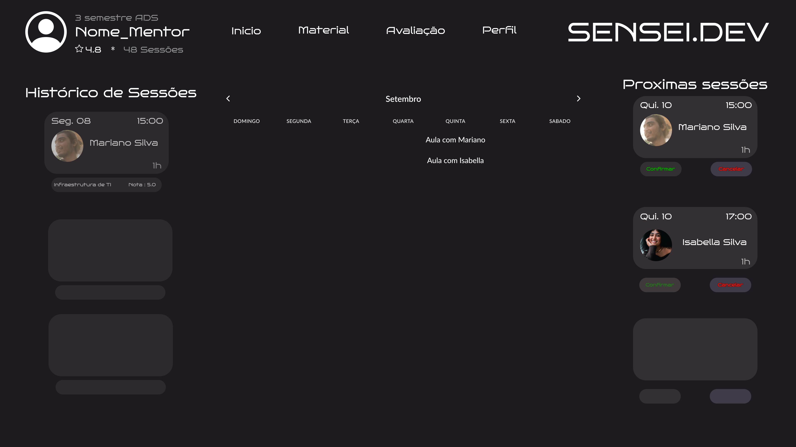
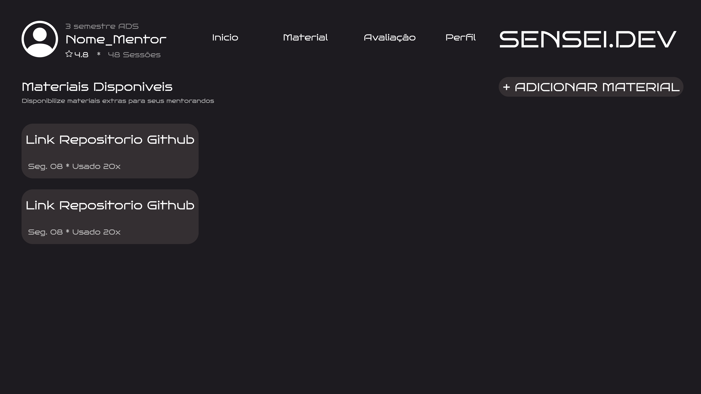
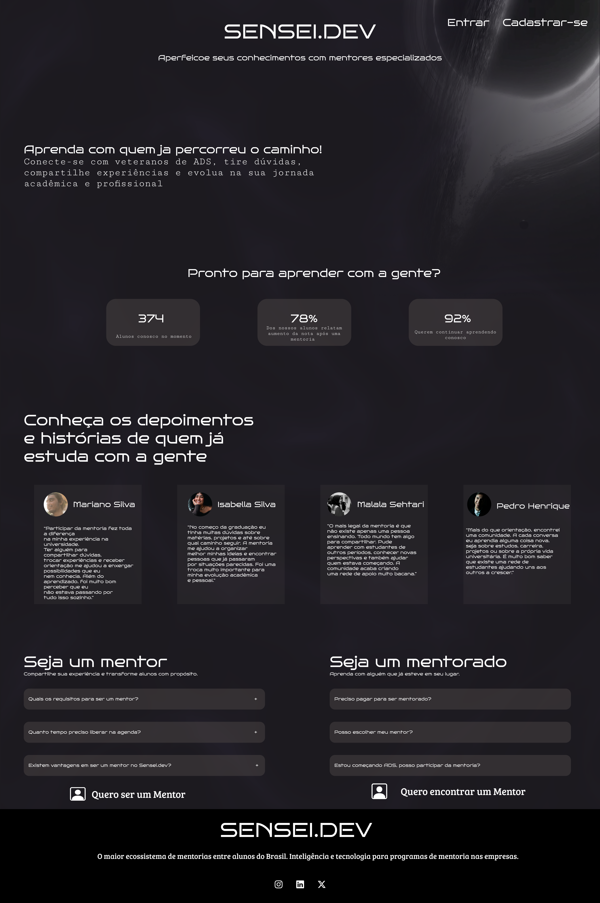
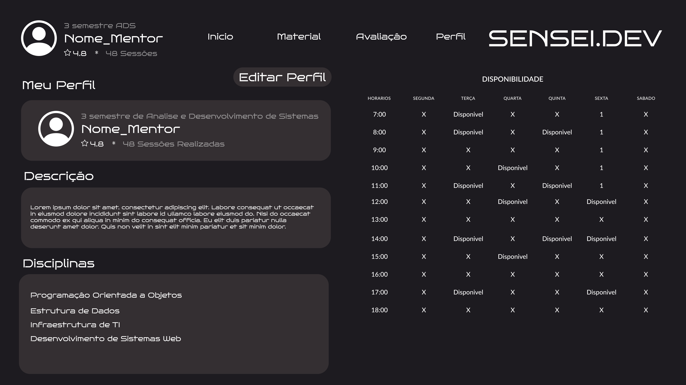

## 1. Sobre o sensei.dev

O sensei.dev é uma plataforma que conecta **mentores** (veteranos com conhecimento acumulado no curso) e **mentorandos** (calouros ou alunos buscando orientação) por meio de sessões agendadas. Nosso objetivo é reduzir a barreira de entrada de quem está começando, aproveitando conhecimento que já existe dentro da própria comunidade — sem depender de grupos informais e fragmentados.

## 2. Cadastro e responsabilidade da conta

- Cada usuário é responsável pelas informações que fornece no cadastro (nome, curso, período, áreas de conhecimento).

- Mentores devem cadastrar apenas áreas em que possuem conhecimento real. A reputação do sistema depende disso.

## 3. Conduta nas sessões

- A conduta nas sessões são pautadas principalmente no respeito mútuo e colaboração. Qualquer tipo de discriminação é repudiada pela plataforma e resultará em suspensão da plataforma. 

## 4. Aviso: uso de Inteligência Artificial na mentoria

Esta é a parte que consideramos mais importante — e pedimos atenção especial.

O sensei.dev nasceu de uma premissa simples: **conhecimento técnico se constrói, não se terceiriza.** A mentoria entre alunos existe porque acreditamos que aprender com alguém que já passou pelo mesmo caminho — que errou, debugou, ficou travado e resolveu — tem um valor que nenhuma resposta pronta substitui.

Vivemos um momento em que ferramentas de IA generativa são cada vez mais capazes de responder qualquer pergunta técnica em segundos. Isso é útil, e não estamos aqui para demonizar essas ferramentas — muitos de nós as usamos no dia a dia. Mas existe uma **linha tênue** que precisa ser reconhecida:

> **Usar IA para acelerar o entendimento é diferente de usar IA para evitar o entendimento.**

# FUNCIONALIDADES

## 1. Área logada do mentor.

O mentor terá uma área exclusiva para gerenciar sua atuação na plataforma.

Principais funcionalidades:

- Perfil de mentor: nome, curso, período, áreas de conhecimento, descrição e experiência.

- Disponibilidade: definição dos dias e horários em que está disponível para realizar mentorias.

- Agenda: visualização das mentorias agendadas, próximas sessões e histórico.

- Solicitações de mentoria: visualizar, aceitar ou recusar solicitações de mentorandos.

- Histórico de sessões: registro das mentorias realizadas.

- Avaliações: acompanhamento das avaliações recebidas após as sessões.

- Notificações: avisos sobre novas solicitações, alterações e cancelamentos.

- Gerenciamento de materiais: possibilidade de disponibilizar materiais complementares para os mentorandos.

## 2. Área logada do mentorando.

O mentorando terá um espaço personalizado para encontrar mentores e acompanhar sua jornada.

Principais funcionalidades:

- Perfil do mentorando: curso, período e áreas nas quais busca orientação.

- Busca de mentores: encontrar mentores por área de conhecimento, curso, período e avaliação.

- Perfil detalhado do mentor: visualizar informações, especialidades, avaliações e horários disponíveis.

- Solicitação de mentoria: escolher um mentor e solicitar uma sessão.

- Minhas mentorias: visualizar sessões futuras, realizadas e canceladas.

- Histórico: acompanhar as mentorias que já realizou.

- Avaliação da sessão: avaliar a experiência após cada mentoria.

- Favoritos: salvar mentores para consultar posteriormente.

- Notificações: receber lembretes e atualizações sobre suas mentorias.

## 3. Agenda para marcação de mentorias

A agenda é uma das funcionalidades centrais da plataforma.

O mentor define previamente seus horários disponíveis, enquanto o mentorando visualiza apenas os horários livres e escolhe aquele que melhor atende à sua necessidade.

O app seguira o seguinte fluxo:

Mentor define disponibilidade → Mentorando escolhe horário → Solicitação é criada → Mentor confirma → Sessão é agendada

A agenda deve permitir:

- Visualização por dia, semana e mês.
- Definição de horários disponíveis pelo mentor.
- Bloqueio de horários indisponíveis.
- Escolha da duração da sessão.
- Agendamento e cancelamento.
- Reagendamento.
- Confirmação automática da sessão, caso essa seja a regra adotada.
- Lembretes antes da mentoria.
- Histórico de horários ocupados e sessões realizadas.
- Impedir conflitos de horário.

## 4. Sistema de avaliações e reputação

Depois de cada sessão, o mentorando poderá avaliar o mentor.

Exemplo:

Nota: ⭐ 4,8/5

Critérios:

- Clareza da explicação.
- Domínio do assunto.
- Pontualidade.
- Capacidade de orientar o raciocínio;
- Experiência geral.
- Também seria interessante permitir uma avaliação textual.

## 5. Objetivo da mentoria
Antes de agendar, o mentorando informa:

"O que você deseja aprender nesta sessão?"

Por exemplo:

- Entender ponteiros em C;
- Revisar orientação a objetos;
- Tirar dúvidas sobre banco de dados;
- Entender um erro no código;
- Preparar-se para uma prova;
- Orientação sobre carreira.

## 6 . Modelagem do banco de dados

O modelo relacional completo está descrito em DBML na pasta [`escopo_db`](./escopo_db):

- **`banco_relacional.dbml`** — definição de todas as tabelas, atributos, chaves primárias/estrangeiras e relacionamentos.
- **`banco_relacional.sql`** — script SQL (PostgreSQL) gerado automaticamente a partir do `.dbml`, pronto pra referência ou adaptação quando formos utilizar o H2.

### Como visualizar o diagrama 

O arquivo `.dbml` não é só texto — ele pode ser visualizado como diagrama em tempo real:

1. Instale a extensão **DBML** no VSCode (busque por "dbml" na aba de extensões).
2. Abra o arquivo `escopo_db/banco_relacional.dbml`.
3. Use `Ctrl+Shift+P` → **"DBML: Preview"** (ou o ícone de preview no canto superior direito do editor).
4. O diagrama abre em uma aba ao lado e se atualiza automaticamente conforme o arquivo é editado.

### Visão geral das tabelas (13)

**Usuários e perfis**
- `usuario` — dados base de todo cadastrado (nome, email, senha, semestre, status)
- `mentor_perfil` — extensão 1:1 de quem atua como mentor (descrição, experiência, nota média)
- `mentorando_perfil` — extensão 1:1 de quem atua como mentorando

**Disciplinas**
- `disciplina` — disciplinas da grade do curso, por semestre
- `mentor_disciplina` — quais disciplinas cada mentor domina (N:N)
- `mentorando_disciplina_interesse` — quais disciplinas cada mentorando busca ajuda (N:N)

**Agenda**
- `disponibilidade` — horários recorrentes livres do mentor
- `bloqueio_horario` — exceções pontuais de indisponibilidade

**Sessões**
- `mentoria` — a solicitação/sessão em si (mentor, mentorando, disciplina, objetivo, data/hora, status)
- `avaliacao` — avaliação pós-sessão por critério (clareza, domínio, pontualidade, capacidade de orientar, experiência geral)

**Complementos**
- `material` — arquivos disponibilizados pelo mentor, gerais ou vinculados a uma sessão
- `notificacao` — avisos de novas solicitações, confirmações e cancelamentos
- `favorito` — mentores salvos por um mentorando (N:N)

### MER (modelo conceitual completo)

## 7. Telas do protótipo

Formulário de cadastro específico para quem entra como mentor.

Formulário de cadastro específico para quem entra como mentorando.

Tela de login, compartilhada entre mentores e mentorandos.

Histórico de avaliações e seus respectivos atríbutos,  recebidas pelo mentor após as sessões.

Dashboard inicial do mentor, com visão geral da agenda e atividades.

Gerenciamento dos materiais complementares disponibilizados pelo mentor.

Tela de entrada da plataforma, onde o usuário escolhe se quer acessar como mentor ou como mentorando.

Tela de perfil do mentor, com descrição, experiência e disciplinas que domina.

Dashboard inicial do mentorando.

Sessões futuras, realizadas e canceladas do mentorando.

Central de notificações e lembretes do mentorando.

Tela de perfil do mentorando, com disciplinas de interesse.

## 8. Ambiente de desenvolvimento

### Tecnologias
- Java 11 e Maven
- Servlets, JSP e JSTL (sem framework) e JDBC puro
- Tomcat 7 embutido (plugin `tomcat7-maven-plugin`)
- Banco H2 2.1.214 em arquivo, criado automaticamente na primeira execução

### Estrutura do projeto
- `pom.xml`: dependências e plugins do Maven
- `src/main/java/br/com/senseidev/`
    - `model`: classes de dados
    - `dao`: acesso ao banco (um DAO por entidade, com JDBC)
    - `servlet`: controladores
    - `filter`: `AutenticacaoFiltro` (protege as rotas por login e por tipo de usuário)
    - `listener`: `InicializadorBanco` (cria tabelas, disciplinas e o admin ao subir)
    - `auth`: `SenhaUtil` (hash PBKDF2 das senhas)
- `src/main/webapp/WEB-INF/views/`: páginas JSP (`admin`, `aluno`, `conta`, ...)
- `src/main/webapp/WEB-INF/fragmentos/`: cabeçalhos reutilizáveis
- `escopo_db/`: DBML, SQL do PostgreSQL, SQL do H2 e MER
- `imagens/`: protótipos

### Banco de dados
O banco **não é versionado**. Ao subir o Tomcat, o `InicializadorBanco` cria o arquivo
`db/sensei.mv.db` com as 13 tabelas, as disciplinas base e o usuário administrador.
Cada pessoa tem o seu banco local, e para zerar basta parar o Tomcat e apagar a pasta `db/`.
A URL é `jdbc:h2:./db/sensei` (usuário `sa`, senha `sa`), configurada no `web.xml`.
O modelo relacional original está em `escopo_db/banco_h2.sql`.

### Como executar
1. Abrir o projeto no IntelliJ com JDK 11.
2. Na raiz do projeto, executar `mvn tomcat7:run` (ou `tomcat7:run` no painel Maven).
   Atenção: o goal é `run`, e `deploy` não funciona.
3. Aplicação: http://localhost:8080
4. Console do H2: http://localhost:8080/console (driver `org.h2.Driver`,
   URL `jdbc:h2:./db/sensei`, usuário `sa`, senha `sa`). O console abre com
   `jdbc:h2:~/test` preenchido, então é preciso trocar a URL.

### Perfis de acesso
| Perfil | Como entra | Área |
|---|---|---|
| Mentor | Cadastro na tela inicial | Área do mentor e "Minha conta" |
| Mentorando | Cadastro na tela inicial | Início do aluno e "Minha conta" |
| Administrador | Não tem cadastro: é criado pelo sistema | `/admin/inicio` |

Login inicial do administrador: `admin@sensei.dev` / `admin12345`
(senha de desenvolvimento, para ser trocada antes de qualquer uso real).

### Administração
- **Usuários** (`/admin/usuarios`): listar, editar, suspender/reativar e excluir mentores e mentorandos.
  O administrador não pode ser suspenso nem excluído, e o e-mail dele é fixo.
- **Disciplinas** (`/admin/disciplinas`): criar, editar e excluir. A exclusão é recusada
  se a disciplina estiver em uso.
- Contas suspensas não conseguem fazer login.

### Conta do usuário
Mentor e mentorando editam nome, e-mail, semestre e senha em `/conta`.
O usuário editado é sempre o da sessão.

### Busca e perfil do mentor
- O mentorando autenticado usa `/inicio-aluno` para filtrar mentores ativos por
  disciplina, semestre da disciplina e avaliação mínima. É possível selecionar
  um resultado e abrir seu perfil.
- `/mentor-publico?id=...` mostra descrição, experiência, disciplinas,
  avaliações e a disponibilidade semanal cadastrada. O perfil é somente de
  leitura e exige sessão de mentorando.
- A escolha de uma data e o envio de uma solicitação de mentoria pertencem à
  etapa P2-06; a grade semanal ainda não confirma uma vaga em uma data específica.
- Na P2-05, o mentorando pode salvar e remover mentores favoritos na busca ou
  no perfil público. A lista "Meus favoritos" fica na própria página inicial.
